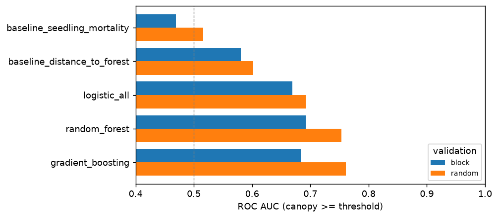
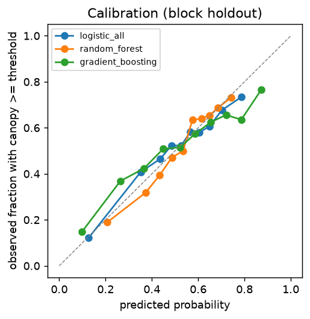
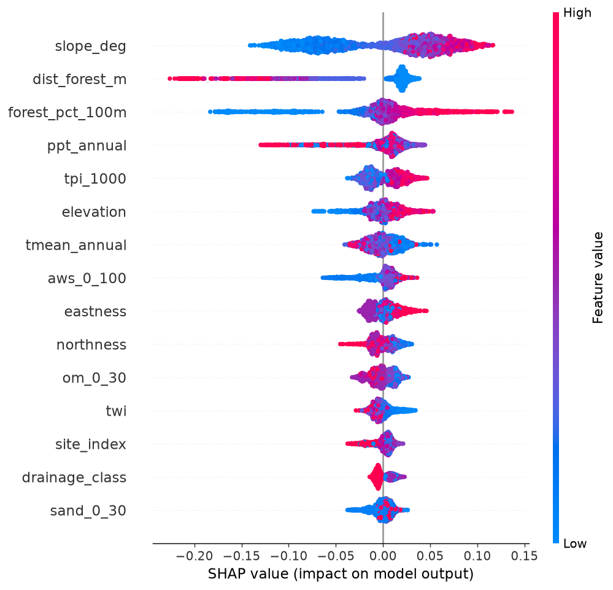

# Results

Generated by `uv run landscore train` on 2026-11-13. Do not edit by hand;
rerun the command. Counties: Geauga. Labeled pixels: 5,545
(positive rate 52.2%).

Target: canopy cover >= 40% measured 15 years after a
field stopped being farmed (abandonment 1988-2009).
This is a stand-in for planting success. It measures site potential for natural regrowth,
not survival of planted trees.

Validation: **No county holdout yet: only one county is built.** The headline here is **block** (5 km spatial blocks), which is weaker evidence than county holdout. Do not quote these numbers as county-holdout results. **block** = 5 km spatial blocks. **random** = random 5-fold
(optimistic, shown for contrast).

## Verdict

Under block holdout the best main model (random_forest, AUC 0.692) beats the best baseline (logistic_all, AUC 0.669) by +0.023 AUC.

## Binary target (canopy >= 40%)

| model | auc (block) | brier_skill (block) | auc (random) | brier_skill (random) |
|---|---|---|---|---|
| baseline_seedling_mortality | 0.469 | -0.012 | 0.516 | 0.001 |
| baseline_distance_to_forest | 0.581 | 0.077 | 0.602 | 0.082 |
| logistic_all | 0.669 | 0.100 | 0.692 | 0.128 |
| random_forest | 0.692 | 0.119 | 0.753 | 0.201 |
| gradient_boosting | 0.684 | 0.093 | 0.761 | 0.216 |

AUC: 0.5 = chance, 1 = perfect ranking. Brier skill: 0 = no better than always predicting the
base rate, 1 = perfect.

## Regression target (canopy percent)

| model | r2 (block) | spearman (block) | r2 (random) | spearman (random) |
|---|---|---|---|---|
| baseline_seedling_mortality | -0.027 | -0.080 | 0.002 | 0.035 |
| baseline_distance_to_forest | 0.191 | 0.237 | 0.197 | 0.262 |
| logistic_all | 0.212 | 0.375 | 0.252 | 0.414 |
| random_forest | 0.245 | 0.436 | 0.371 | 0.548 |
| gradient_boosting | 0.169 | 0.367 | 0.427 | 0.587 |

## Calibration (block holdout)

## Feature importance (SHAP, random_forest, fit on all data)

## Human checks (not done yet)

1. **Forester blind ranking.** A forester ranks ~20 plots without seeing scores; we report the
   rank correlation with the model. *Result: pending.*
2. **Roots planting sites.** Case studies of Roots of Tomorrow's own sites compared with
   observed survival notes. *Result: pending.*

## Lidar check

See the lidar section of `docs/METHODS.md` when available. *Result: pending.*
